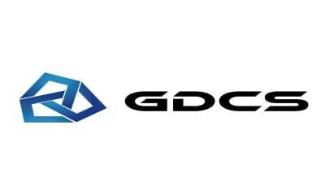

# WeKit

适用于微信的增强模块，支持 Xposed 和 Zygisk 两种加载方式。

 

## 文档

请参阅 [文档](https://docs.wekit.ujhhgtg.dev) 以使用本模块。

- [🚀 快速开始](https://docs.wekit.ujhhgtg.dev/getting-started)
- [📥 安装指南](https://docs.wekit.ujhhgtg.dev/installation)
- [🧩 Zygisk 模式](https://docs.wekit.ujhhgtg.dev/zygisk)
- [⚙️ 配置指南](https://docs.wekit.ujhhgtg.dev/configuration)
- [❓ 常见问题](https://docs.wekit.ujhhgtg.dev/faq)
- [🛠 开发指南](https://docs.wekit.ujhhgtg.dev/development)

## 翻译 / Translation

欢迎通过 [Hosted Weblate](https://hosted.weblate.org/projects/wekit/wekit/) 参与简体中文和
繁体中文翻译。贡献流程、术语和本地校验说明见[翻译贡献指南](docs/translations/index.md)。

## 联系

[Telegram 超级群组](https://t.me/+7j5dJ6g16B43OWVl)

[爱发电](https://ifdian.net/a/ujhhgtg)

## 致谢

[WeKit 上游](https://github.com/cwuom/WeKit)

[WAuxiliary](https://github.com/HdShare/WAuxiliary_Public)

[NewMiko](https://github.com/dartcv/NewMiko/blob/archives/)

[QAuxiliary](https://github.com/cinit/QAuxiliary)

[FingerprintPay](https://github.com/eritpchy/FingerprintPay)

[WADN](https://github.com/Ujhhgtg/wauxv_deobf_new) [WAD](https://github.com/Ujhhgtg/wauxv_deobf)

*^^^ 如果你需要一些我尚未从 WAuxiliary ~~抄袭~~提取的功能, 你可以自行从此处移植; 欢迎 PR!*

[FunBox](https://github.com/Ujhhgtg/funbox_deobf)

[I-Am-Pad](https://github.com/Houvven/I-Am-Pad)

## 赞助

WeKit Fork 是一个利用业余时间开发和维护的项目。如果你愿意支持本项目，并希望出现在这里，欢迎[创建 Issue](https://github.com/Ujhhgtg/WeKit/issues/new)、通过 [Telegram](https://t.me/+7j5dJ6g16B43OWVl) 联系我，或[发送邮件](mailto:feyxiexzf@gmail.com)。

<table>
<tr>
<td width="240" align="center"></td>
<td>

<strong>高端GPU显卡服务器直购专区：</strong>

<a href="https://gdc-server.com/cart?action=configureproduct&amp;pid=882">https://gdc-server.com/cart?action=configureproduct&amp;pid=882</a>

<strong>阿里云/腾讯云/AWS/GCP低至8折代充</strong>

阿里云国际站，50美金起充送账号。充值200$ 送账号并享受 95 折。充值500$ 送账号并享受 9 折，充值1000$ 送账号并享 8 折。

腾讯云国际站 50美金起充送账号。充值200$ 送账号并享受 95 折。充值500$ 送账号并享受 9 折，充值1000$ 送账号并享 8 折

AWS亚马逊云代充值，AWS 500美金起充送账号。充值1000$ 送账号并享 98 折。充值2000$送账号并享 96 折，充值5000$ 送账号并享受 95 折。

GCP谷歌云代充值，GCP 500美金起充送账号。充值1000$ 送账号并享 98 折。充值2000$送账号并享 96 折，充值5000$ 送账号并享受 95 折。

<strong>✈️在线自助充值平台（送账号）</strong> <a href="https://awsdatas.com">https://awsdatas.com</a>

</td>
</tr>
</table>

---

   </img>

